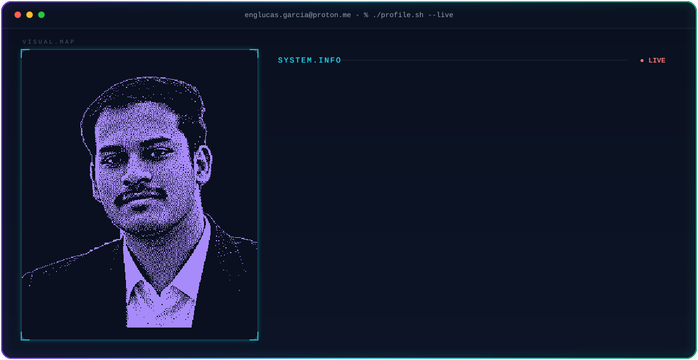

<picture>
  <source media="(prefers-color-scheme: dark)" srcset="./portrait_dark.svg">
  <source media="(prefers-color-scheme: light)" srcset="./portrait_light.svg">
  
</picture>

  

<picture>
  <source
    media="(prefers-color-scheme: dark)"
    srcset="https://github-readme-streak-stats-eight.vercel.app/?user=GarciaFerreiraLucas&hide_border=true&background=0A101F&stroke=22D3EE&ring=A78BFA&fire=10B981&currStreakLabel=22D3EE&sideLabels=94A3B8&currStreakNum=F8FAFC&sideNums=F8FAFC&dates=64748B&titleColor=22D3EE&card_width=1180"
  />
  <source
    media="(prefers-color-scheme: light)"
    srcset="https://github-readme-streak-stats-eight.vercel.app/?user=GarciaFerreiraLucas&hide_border=true&background=0A101F&stroke=22D3EE&ring=A78BFA&fire=10B981&currStreakLabel=22D3EE&sideLabels=94A3B8&currStreakNum=F8FAFC&sideNums=F8FAFC&dates=64748B&titleColor=22D3EE&card_width=1180"
  />
  
</picture>

  

<picture>
  <source
    media="(prefers-color-scheme: dark)"
    srcset="https://github-stats-extended.vercel.app/api?username=GarciaFerreiraLucas&show_icons=true&hide_rank=true&hide_border=true&title_color=22D3EE&icon_color=A78BFA&text_color=94A3B8&bg_color=0A101F&card_width=500"/>
  <source
    media="(prefers-color-scheme: light)"
    srcset="https://github-stats-extended.vercel.app/api?username=GarciaFerreiraLucas&show_icons=true&hide_rank=true&hide_border=true&title_color=0F172A&icon_color=7C3AED&text_color=475569&bg_color=FFFFFF&card_width=500"/>
  
</picture>
<picture>
  <source
    media="(prefers-color-scheme: dark)"
    srcset="https://github-stats-extended.vercel.app/api/top-langs/?username=GarciaFerreiraLucas&layout=compact&langs_count=8&hide_border=true&title_color=22D3EE&text_color=94A3B8&bg_color=0A101F&card_width=500"
  />
  <source
    media="(prefers-color-scheme: light)"
    srcset="https://github-stats-extended.vercel.app/api/top-langs/?username=GarciaFerreiraLucas&layout=compact&langs_count=8&hide_border=true&title_color=0F172A&text_color=475569&bg_color=FFFFFF&card_width=500"
  />
  
</picture>

  

<picture>
  <source media="(prefers-color-scheme: dark)" srcset="https://raw.githubusercontent.com/GarciaFerreiraLucas/GarciaFerreiraLucas/output/snake-dark.svg" />
  <source media="(prefers-color-scheme: light)" srcset="https://raw.githubusercontent.com/GarciaFerreiraLucas/GarciaFerreiraLucas/output/snake-light.svg" />
  
</picture>

  

&nbsp;&nbsp;

&nbsp;&nbsp;

&nbsp;&nbsp;

---

## 👨‍💻 About

Sou **Engenheiro de Software** e **Chefe do DTI (Diretoria de Tecnologia da Informação)** na Prefeitura Municipal de Quirinópolis — GO, graduado pela **UniRV** (Universidade de Rio Verde).

Minha trajetória técnica é centrada na construção de **sistemas distribuídos resilientes, arquitetura de microsserviços e sustentação de infraestrutura corporativa**. Uno engenharia de software moderna (Clean Architecture, DDD, TDD) com governança de ambientes virtualizados em **Proxmox VE**, garantindo alta densidade, isolamento de recursos e segurança para serviços de missão crítica.

* **Foco Técnico:** Java (Spring Boot) • Go • TypeScript • Next.js 14 / React 19 • PostgreSQL • Docker • Proxmox VE • AI Agents (LLMs & Whisper)
* **Liderança & Governança:** Gestão do parque de TI municipal, modernização de processos e alta disponibilidade 24/7
* **Princípios de Engenharia:** Clean Architecture • Domain-Driven Design • Microservices • High Scalability • Real-Time Systems

---

## 🛠️ Tech Stack

### Languages

### Frontend & UI

### Backend & Databases

### DevOps, Infra & Cloud

### Core Competencies

---

## 🚀 Featured Projects

<strong>01 · DTI Agent & Platform — Atendimento Inteligente com IA & Gestão Operacional de TI</strong>

 

Ecossistema corporativo completo de suporte técnico e governança operacional para a Prefeitura Municipal de Quirinópolis. Integra um agente de IA autônomo no WhatsApp capaz de realizar triagem inteligente, normalização contextual de locais e transcrição de áudios com um painel operacional em tempo real para os técnicos e gestores.

| Dimensão | Detalhes |
| :--- | :--- |
| **Stack Frontend** | React 19 • TypeScript • Vite • Tailwind CSS • Framer Motion • @dnd-kit (Kanban) • FullCalendar |
| **Stack Backend & IA** | Node.js (Express) • TypeScript • Groq SDK (Llama 3.1 & Whisper v3) • WAHA • Prisma • PostgreSQL 16 |
| **Recursos em Tempo Real** | Triagem inteligente de chamados, transcrição de áudio, fila e Kanban sincronizados via WebSockets (Socket.io) |
| **Infra & Alta Disponibilidade** | Docker Compose multi-container, virtualização LXC no Proxmox VE, snapshots de recuperação (<2min) e túneis reversos |
| **Live Link** | [Visualizar no Portfólio](https://lucasgarciadev.netlify.app/) |

 

<strong>02 · Cê Vai? Tickets — Plataforma SaaS de Venda de Ingressos</strong>

 

Plataforma SaaS desenvolvida para venda de ingressos e gestão inteligente de eventos em tempo real, integrando checkout transacional seguro e controle de portaria via QR Code anti-fraude.

| Dimensão | Detalhes |
| :--- | :--- |
| **Stack** | Next.js 14 • React • Go (Golang) • PostgreSQL • Tailwind CSS • Framer Motion |
| **Escopo** | SaaS em produção com gestão simultânea de lotes e produtores |
| **Diferencial** | Validação sub-100ms em portarias offline/online e blindagem contra double-spending |
| **Live Link** | [Visualizar no Portfólio](https://lucasgarciadev.netlify.app/) |

 

<strong>03 · Burger House — Ecossistema de Food Service & Delivery</strong>

 

Aplicação web completa para restaurantes e hamburguerias com catálogo interativo, fluxo de pedido dinâmico, carrinho reativo e painel de despacho integrado para a cozinha.

| Dimensão | Detalhes |
| :--- | :--- |
| **Stack** | React • Vite • TypeScript • Tailwind CSS • Firebase • Netlify |
| **Escopo** | Aplicação de ponta a ponta com fluxo de compra em 3 etapas |
| **Impacto** | Redução de até 40% no tempo de atendimento de balcão e eliminação de pedidos manuais |
| **Live Link** | [Visualizar no Portfólio](https://lucasgarciadev.netlify.app/) |

 

<strong>04 · GUIN — Gestão Unificada de Infraestrutura de TI</strong>

 

Sistema interno de governança técnica para inventário de ativos de hardware/software, telemetria de servidores físicos e virtuais (Proxmox) e gestão unificada de chamados municipais.

| Dimensão | Detalhes |
| :--- | :--- |
| **Stack** | Java (Spring Boot) • TypeScript • PostgreSQL • Docker • Proxmox API • GSAP |
| **Escopo** | Gestão centralizada dos departamentos e secretarias municipais |
| **Diferencial** | Monitoramento automatizado de métricas de host (CPU, memória, I/O) e histórico de manutenções |
| **Live Link** | [Visualizar no Portfólio](https://lucasgarciadev.netlify.app/) |

 

<strong>05 · DTI Gov Platform — Modernização dos Serviços Públicos Municipais</strong>

 

Infraestrutura de tecnologia da Prefeitura de Quirinópolis, consolidando servidores legados em clusters de virtualização de alta densidade e digitalizando processos cidadãos.

| Dimensão | Detalhes |
| :--- | :--- |
| **Stack** | Linux Server • Proxmox VE • Docker • PostgreSQL • Nginx Reverse Proxy • Firewall pfSense |
| **Escopo** | Sustentação e alta disponibilidade para todo o ecossistema institucional público |
| **Segurança** | Rotinas automatizadas de backup corporativo, redundância de rede e segmentação de VLANs |

---

## 💼 Experiência & Liderança

### Chefe da Diretoria de Tecnologia da Informação (DTI)
**Prefeitura Municipal de Quirinópolis — GO**
* Liderança técnica do ecossistema de TI municipal, coordenando infraestrutura de redes, datacenters e sistemas corporativos.
* Concepção e implantação do **DTI Agent & Platform**: automação inteligente de atendimento com IA (Groq LLM/Whisper) via WhatsApp integrada a frontend gerencial em React 19.
* Planejamento e implantação do cluster virtualizado em Proxmox VE, consolidando servidores físicos com alta densidade e isolamento de falhas.
* Implementação de rotinas de backup corporativo, segurança de dados institucionais e digitalização de serviços ao munícipe.

### Software Engineer / Consultor Full Stack
**Projetos Corporativos & Freelance**
* Desenvolvimento de APIs RESTful e microsserviços em Java (Spring Boot) e Go, com foco em concorrência e baixo consumo de recursos.
* Construção de interfaces reativas e componentizadas em Next.js 14, React 19, TypeScript e Tailwind CSS.

---

<h3 style="font-family: monospace; font-size: 15px; color: #94A3B8;"><code>Construindo sistemas resilientes. Engenharia com precisão. Arquitetura para o futuro.</code></h3>

 

